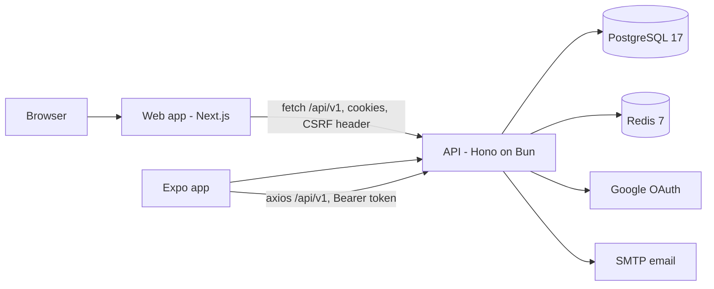

# FitPal

FitPal is a Bun/Turborepo monorepo containing a Hono API, a Next.js public website, an Expo mobile app, and a shared Drizzle/PostgreSQL data layer. The product is a fitness companion for logging workouts, routines, and nutrition.

The repository currently contains a working backend and an early mobile client. The website is a public marketing/feature site; authenticated web screens are not implemented yet. See [Implementation status](#implementation-status) before assuming a capability is complete.

## Contents

- [Implementation status](#implementation-status)
- [Tech stack](#tech-stack)
- [Architecture](#architecture)
- [Prerequisites](#prerequisites)
- [Fresh-clone setup](#fresh-clone-setup)
- [Environment configuration](#environment-configuration)
- [Running the applications](#running-the-applications)
- [Deployment](#deployment)
- [Database operations](#database-operations)
- [API documentation](#api-documentation)
- [Authentication](#authentication)
- [Testing and quality checks](#testing-and-quality-checks)
- [Troubleshooting](#troubleshooting)
- [Documentation map](#documentation-map)
- [Contributing](#contributing)

## Implementation status

| Area | Implemented in this repository | Not implemented or still partial |
| --- | --- | --- |
| Web | Public Next.js site with `/` and six `/features/*` routes, animated phone mockups, responsive design, sitemap, and robots | Login/signup/dashboard routes, web OAuth UI, authenticated product screens. `apps/web/lib/api-client.ts` and `apps/web/lib/auth.ts` exist but are not used by any page. |
| API | Hono app with health/readiness probes and `/api/v1` groups for auth, workouts, routines, exercises, progress, foods, meals, nutrition, and meal plans | `community`, `ai`, and `devices` routers are commented out in `apps/api/src/app.ts`. No OpenAPI/Swagger route exists. |
| Auth | Email/password, OTP verification, Google OAuth, password recovery, Redis sessions, cookie auth for web clients, Bearer auth for mobile, CSRF protection | No real SMS provider (`mock` or `disabled` only). Gmail SMTP is the only email provider and is documented as development-only. |
| Mobile | Expo Router app with login, signup, forgot-password, Google sign-in, SecureStore session handling, logout, and tab shell | Home/Workout/Routines/Logbook/Profile are largely static previews. The signup OTP state machine exists in `apps/mobile/src/lib/signup.ts` but is not wired into the current signup screen. |
| Data | Drizzle schema, 12 SQL migrations, PostgreSQL 17, Redis 7, Compose dev stack | No `seed` script. Migration `0004_heavy_killer_shrike.sql` inserts shared exercise rows. |
| AI | `packages/ai` with LLM client and prompt scaffolding | Not imported by the API; `/ai` is not mounted. Prompt functions are placeholders. |

## Tech stack

| Area | Technologies actually used |
| --- | --- |
| Monorepo | Bun `1.3.14` (`packageManager`), Turborepo `^2`, TypeScript `^5` (mobile uses `~6.0.3`), Biome `^1` |
| API/backend | Bun, Hono `^4`, Zod `^3`, Drizzle ORM `^0.38`, `postgres` `^3`, ioredis `^5`, `jose` `^5`, `@node-rs/bcrypt`, Nodemailer, `libphonenumber-js` |
| Web | Next.js `16.2.6`, React `19.2.4`, Tailwind CSS `^4`, shadcn-style local components, Motion/Framer Motion, Lenis, Lucide, ESLint `^9` |
| Mobile | Expo `^58.0.22`, Expo Router `~58.0.29`, React Native `0.88.1`, React `19.3.0`, Axios, TanStack Query `5.105.0`, React Hook Form, Zod, Expo Secure Store, Expo Web Browser |
| Database | PostgreSQL `17-alpine`, Drizzle Kit `^0.30`, migrations in `packages/database/src/migrations` |
| Cache/session infrastructure | Redis `7-alpine`, ioredis; Redis stores sessions and rate-limit state |
| Authentication | Custom 7-day Redis-backed sessions, HttpOnly session cookies, Bearer tokens from mobile SecureStore, OTP with HMAC pepper, Google OAuth/OIDC, double-submit CSRF |
| Styling/UI | Tailwind CSS `^4`, CSS tokens in `apps/web/app/globals.css`, local UI primitives in `apps/web/components/ui`, Lucide icons |
| Testing/quality | `bun test`, Biome, ESLint, `tsc --noEmit`, Turborepo task runner, GitHub Actions CI |

## Architecture

```text
fitpal/
├─ apps/
│  ├─ api/                     Hono API on Bun
│  │  ├─ src/app.ts            app assembly, /api/v1 prefix, middleware
│  │  ├─ src/routes/           auth and domain route groups
│  │  ├─ src/services/         auth, OTP, OAuth, email, SMS, limits
│  │  └─ test/                 Bun tests and test setup
│  ├─ web/                     Next.js App Router marketing site
│  │  ├─ app/                  routes, global CSS, sitemap, robots
│  │  ├─ components/           shared UI, motion, phone mockups
│  │  └─ lib/                  API/auth client helpers
│  └─ mobile/                  Expo Router app
│     ├─ app/                  auth, tab, and root routes
│     └─ src/                  API client, auth helpers, UI
├─ packages/
│  ├─ ai/                      LLM client and prompt scaffolding
│  ├─ database/                Drizzle schema, migrations, DB scripts
│  └─ shared/                  shared types/utilities
├─ docker/                     Compose files and Dockerfiles
├─ documents/                  specs, research, auth runbooks
├─ .github/workflows/          CI/CD workflows
├─ package.json                workspace scripts
├─ turbo.json                  task pipeline
└─ .env.example                root environment template
```



### Application responsibilities

- `apps/api` owns all persistence, authentication, and domain business logic. It mounts routes under `/api/v1` and exposes unversioned `/health` and `/readyz` probes.
- `apps/web` is currently a public marketing site. Its API helper uses `fetch`, sends cookies, and performs the double-submit CSRF handshake, but no page imports it yet.
- `apps/mobile` is the client with real auth flows and a tab shell. Most tab content is still preview data.
- `packages/database` exports the Drizzle schema and owns migrations. The schema is split by domain under `packages/database/src/schema`.
- `packages/shared` holds shared code. `packages/ai` is not currently wired into the API.

### API communication

The web client uses `apps/web/lib/api-client.ts`: base origin from `NEXT_PUBLIC_API_URL` (default `http://localhost:3001`), prefix `/api/v1`, `credentials: "include"`, and `X-CSRF-Token` for unsafe methods.

The mobile client uses `apps/mobile/src/lib/api.ts`: Axios `baseURL` of `${API_URL}/api/v1`, a Bearer token read from `auth_token` in Expo SecureStore, and token deletion on HTTP 401. In development the API host is derived from Metro's `hostUri` and port `3011`; production builds use `EXPO_PUBLIC_API_URL`.

### Infrastructure dependencies

PostgreSQL stores users, OTP state, workouts, routines, nutrition data, and session-version invalidation state. Redis stores 7-day sessions and rate-limit buckets. In Docker Compose, the `migrate` service applies migrations before the API starts; the API waits for healthy Postgres and Redis services.

## Prerequisites

| Requirement | Version/evidence | Needed for |
| --- | --- | --- |
| Bun | `1.3.14`, pinned in root `package.json` and `bun-types`/Docker images | All local install, script, and test commands |
| Node.js | No host version is enforced. Docker web build/runtime uses `node:22` in `docker/Dockerfile.web` | Docker web image only |
| PostgreSQL | `17-alpine` in Compose and CI | API and migrations |
| Redis | `7-alpine` in Compose and CI | API sessions and rate limits |
| Git | No version pinned | Clone and contribution workflow |
| Docker Compose | Optional; used by `docker/docker-compose.yml` | Running the full API/web stack in containers |
| Expo tooling | Expo SDK 58 dependencies in `apps/mobile/package.json`; Expo Go or an emulator/simulator | Mobile development |
| Xcode / Android Studio | Needed only for iOS simulator / Android emulator or native builds | Mobile simulator/device workflows |

## Fresh-clone setup

### 1. Clone and install

```bash
git clone <repository-url> fitpal
cd fitpal
bun install --frozen-lockfile
```

`bun.lock` is committed and CI uses `--frozen-lockfile`.

### 2. Create local environment files

```bash
cp .env.example .env
cp apps/mobile/.env.example apps/mobile/.env
```

Both files are gitignored. Fill in real secrets locally only. `OTP_PEPPER` can be generated with:

```bash
openssl rand -hex 32
```

### 3. Start PostgreSQL and Redis

Choose one path.

**Docker Compose (recommended for the API/web stack):**

```bash
cd docker
docker compose up --build
# or, for detached services:
docker compose up -d --build
```

Compose starts `postgres`, `redis`, `migrate`, `api`, and `web`. It hardcodes container-internal database/Redis URLs and runs migrations through the `migrate` service, so no host migration command is required for this path.

**Native services:**

Install and start PostgreSQL 17 and Redis 7 on the host. Create a database/role matching your `DATABASE_URL`. Replace `<your-local-password>` in the examples below with the password you set for the local `fitpal` role. The repository does not provide a script that provisions the native database or role.

The example root `.env` targets native ports:

```bash
export DATABASE_URL='postgres://fitpal:<your-local-password>@localhost:5432/fitpal'
export REDIS_URL='redis://localhost:6379'
```

If you instead use only the Compose databases from host processes, use the published ports:

```bash
export DATABASE_URL='postgres://fitpal:<your-local-password>@localhost:5433/fitpal'
export REDIS_URL='redis://localhost:6380'
```

### 4. Apply migrations (native services only)

`packages/database` does not load `.env` itself; export `DATABASE_URL` first as shown above, then run:

```bash
bun run db:migrate
```

### 5. Start the API

```bash
bun run --cwd apps/api dev
```

The dev script loads the root `.env` and watches `apps/api/src/index.ts`. Native default URL: `http://localhost:3001`.

### 6. Start the web app

```bash
bun run --cwd apps/web dev
```

Native default URL: `http://localhost:3000`. The API client defaults to `http://localhost:3001`. If you want the web app to call a Compose-published API instead, provide the public variable to the web process:

```bash
NEXT_PUBLIC_API_URL=http://localhost:3011 bun run --cwd apps/web dev
```

### 7. Start the mobile app

```bash
cd apps/mobile
bun dev
```

Use `bun android`, `bun ios`, or `bun web` to target a specific platform. Expo prints the Metro URL; no fixed Metro port is configured in this repository. In development, the mobile API origin is derived from Metro's reachable host and uses port `3011`.

To run API, web, and mobile concurrently from a native setup:

```bash
bun run dev
```

## Environment configuration

Never commit `.env` files. Values below are names, purposes, and documented local defaults only. Production startup validates many of these and rejects mock providers.

### API and runtime

| Variable | Purpose | Required | Local default / how to obtain |
| --- | --- | --- | --- |
| `NODE_ENV` | Runtime mode; `production`/`prod` enables strict config checks | Optional locally; required in production | `development` in `.env.example` |
| `PORT` | API listen port | Optional locally; required in production | `3001` |
| `DATABASE_URL` | PostgreSQL connection for API and Drizzle | Yes, at API import and migration time | `postgres://fitpal:<your-local-password>@localhost:5432/fitpal`; use host `5433` for the Compose database |
| `REDIS_URL` | Redis connection for sessions/rate limits | Yes, at API import | `redis://localhost:6379`; use host `6380` for the Compose Redis |
| `TRUSTED_PROXY_IP` | Exact immediate proxy IP when behind a trusted proxy | No | Unset; socket IP is used and `X-Forwarded-For` is ignored |

### Authentication, OAuth, email, and SMS

| Variable | Purpose | Required | Local default / how to obtain |
| --- | --- | --- | --- |
| `OTP_PEPPER` | HMAC pepper for OTP challenges | Yes for OTP flows; strict production startup requires it | Generate a unique 32+ character value, e.g. `openssl rand -hex 32` |
| `JWT_SECRET` | Only checked to ensure it differs from `OTP_PEPPER` | No; not used for session signing | Absent from `.env.example`; do not add unless your deployment requires it |
| `SMS_MODE` | SMS provider mode | Required when SMS is used; production requires `disabled` | `mock`; no real SMS provider exists |
| `EMAIL_PROVIDER` | Email provider selector | Required in production | `gmail`, the only implemented provider |
| `SMTP_HOST` | SMTP server host | When email is sent; production requires it | `smtp.gmail.com` in the template |
| `SMTP_PORT` | SMTP server port | No | `465` |
| `SMTP_SECURE` | SMTP TLS flag | No | `true`; defaults from port `465` |
| `SMTP_USER` | SMTP account user | When email is sent; production requires it | Use a Google App Password account; never commit credentials |
| `SMTP_PASSWORD` | SMTP app password | When email is sent; production requires it | Obtain from your Google Account security settings |
| `EMAIL_FROM` | From identity for email | When email is sent; production requires it | Set a real identity for your deployment |
| `REPLY_TO` | Reply-to identity | Optional locally; required in production | Falls back to `EMAIL_FROM` at runtime |
| `CLIENT_URL` | Fixed web redirect destination and reset-link origin | Required for Google OAuth/reset links and production | `http://localhost:3002`; production requires HTTPS |
| `CORS_ORIGIN` | Comma-separated browser origins allowed with credentials | Optional locally; required in production | `http://localhost:3000,http://localhost:3002`; wildcards are rejected |
| `GOOGLE_CLIENT_ID` | Google OAuth client ID | Required for Google sign-in | Register an OAuth client in Google Cloud Console |
| `GOOGLE_CLIENT_SECRET` | Google OAuth client secret | Required for Google sign-in | Obtain from Google Cloud Console; never commit it |
| `GOOGLE_REDIRECT_URI` | Exact OAuth callback URL | Required for Google sign-in | `http://localhost:3011/api/v1/auth/google/callback`; register this exact URI in Google Cloud Console |
| `MOBILE_OAUTH_SCHEMES` | Allowed deep-link schemes for mobile OAuth | Required for Google sign-in and production | `exp,fitpal`; omit `exp` in production |

### Web, mobile, and tests

| Variable | Purpose | Required | Local default / how to obtain |
| --- | --- | --- | --- |
| `NEXT_PUBLIC_API_URL` | Web API origin; baked into the Next.js bundle | No | `http://localhost:3011` in `.env.example`; source fallback is `http://localhost:3001`. `apps/web/lib/auth.ts` has no fallback. |
| `EXPO_PUBLIC_API_URL` | Mobile API origin in production builds | Production builds | `http://localhost:3011` in `apps/mobile/.env.example`; development derives the host from Metro `hostUri` |
| `TEST_DATABASE_URL` | Disposable database used by DB-backed API tests | No; tests skip DB suites without it | Not in `.env.example`; CI sets it to `fitpal_test` |
| `OPENAI_API_KEY` | Used only if `@fitpal/ai` is imported | No for current API/web/mobile run | Empty in template; API does not use `packages/ai` |
| `ANTHROPIC_API_KEY` | Exported by the AI client | No for current API/web/mobile run | Empty in template; no consumer found |

### Template-only / currently unused keys

`.env.example` still lists `MEILI_HOST`, `MEILI_MASTER_KEY`, `S3_ENDPOINT`, `S3_REGION`, `S3_ACCESS_KEY_ID`, `S3_SECRET_ACCESS_KEY`, and `S3_BUCKET`. The development Compose stack has no Meilisearch or MinIO service, and current API source does not read these keys. Do not configure them expecting active functionality.

`docker/docker-compose.prod.yml` additionally interpolates `POSTGRES_USER`, `POSTGRES_PASSWORD`, and `POSTGRES_DB` for its Postgres service; these are not present in `.env.example`.

## Running the applications

| Application | Command | Local URL/port | Notes |
| --- | --- | --- | --- |
| API (native dev) | `bun run --cwd apps/api dev` | `http://localhost:3001` | Loads root `.env`; watches source |
| API (Compose) | `cd docker && docker compose up --build` | `http://localhost:3011` | Container listens on `3001`, published as `3011` |
| Web (native dev) | `bun run --cwd apps/web dev` | `http://localhost:3000` | Next.js dev server |
| Web (Compose) | `cd docker && docker compose up --build` | `http://localhost:3002` | Container listens on `3000`; `NEXT_PUBLIC_API_URL=http://localhost:3011` is baked in |
| Mobile | `cd apps/mobile && bun dev` | Expo CLI prints Metro URL | `bun android`, `bun ios`, and `bun web` target platforms |

Useful API probes:

```bash
curl http://localhost:3001/health   # native
curl http://localhost:3001/readyz   # native; DB + Redis readiness
```

In Compose, use port `3011` instead.

## Deployment

The public marketing website is deployed on Cloudflare Pages as the `fitpal` project from `MainakSen30/fitpal`. The verified production site is [https://fitpal-33p.pages.dev](https://fitpal-33p.pages.dev). No custom domain is configured for the Pages project; use the `pages.dev` address above.

### Current production

| Field | Value |
| --- | --- |
| Production URL | https://fitpal-33p.pages.dev |
| Provider | Cloudflare Pages |
| Project | `fitpal` |
| GitHub repository | `MainakSen30/fitpal` |
| Production branch | `main` |

Check the Cloudflare Pages dashboard for the current deployment status and deployment ID.

### Branch workflow

- Pushes to `main` trigger production deployments.
- `staging` is configured as a preview branch, so pushes to `staging` trigger preview deployments.
- Pull requests follow the existing GitHub and Cloudflare Pages integration behavior.
- Cloudflare generates a unique preview deployment URL for each preview build; there is no permanent staging URL to document. Find a specific preview URL by opening the `fitpal` project in the Cloudflare Pages dashboard and selecting the relevant deployment.

### Cloudflare Pages build configuration

| Setting | Value |
| --- | --- |
| Root directory | `/` |
| Framework preset | Custom / None |
| Build command | `bun run --cwd apps/web build` |
| Build output directory | `apps/web/out` |
| Bun version | `1.3.14` |
| Required environment variable (Preview and Production) | `BUN_VERSION=1.3.14` |

This Cloudflare Pages build publishes only `apps/web`, the static Next.js marketing site. The Hono API in `apps/api`, PostgreSQL, Redis, and the Expo mobile app are separate and are not deployed by this Pages workflow.

### Local production build

Use the pinned Bun version and the repository's frozen-lockfile install:

```bash
bun install --frozen-lockfile
bun run --cwd apps/web build
```

The generated static output is written to `apps/web/out`, matching the Cloudflare Pages build output directory.

## Database operations

| Operation | Command | Notes |
| --- | --- | --- |
| Generate migration | `bun run db:generate` | Reads `packages/database/src/schema/**/*.ts` and writes to `src/migrations`; review generated SQL |
| Apply migrations | `bun run db:migrate` | Requires `DATABASE_URL`; Compose runs this automatically via the `migrate` service |
| Direct schema sync | `bun run db:push` | Drizzle direct sync; do **not** use it on an existing database as a substitute for reviewed migrations |
| Lint schema package | `bun run --cwd packages/database lint` | Biome |
| Typecheck schema package | `bun run --cwd packages/database typecheck` | `tsc --noEmit` |
| Migration consistency check | `cd packages/database && bunx drizzle-kit check --config drizzle.config.ts` | Requires `DATABASE_URL` |

Schema files live in `packages/database/src/schema`. Migrations are numbered `0000_chunky_siren.sql` through `0011_famous_colonel_america.sql`, with journal metadata in `packages/database/src/migrations/meta/_journal.json`.

There is no `db:seed`, `db:reset`, or down-migration script. Migration `0007_prevent_overlapping_targets.sql` requires the PostgreSQL `btree_gist` extension, so the database role must be able to create it if it is not already present.

**Destructive reset warning:** `cd docker && docker compose down -v` removes both the `pgdata` and `redisdata` named volumes. Plain `docker compose down` stops services without deleting those volumes.

## API documentation

### Base URLs

| Environment | Base URL |
| --- | --- |
| Native API dev | `http://localhost:3001/api/v1` |
| Docker Compose API | `http://localhost:3011/api/v1` |

Unversioned probes are `GET /health` and `GET /readyz`.

### Verified route groups

All groups below are mounted under `/api/v1` in `apps/api/src/app.ts`. Domain groups apply `requireAuth`.

| Group | Endpoints |
| --- | --- |
| Auth | See auth table below |
| Workouts | `POST/GET /workouts`, `GET/PATCH/DELETE /workouts/:id`, exercise and set add/update/delete/reorder routes, `POST /workouts/:id/complete` |
| Routines | `POST/GET /routines`, `GET/PATCH/DELETE /routines/:id`, exercise add/delete/reorder, `POST /routines/:id/start` |
| Exercises | `GET /exercises?search=`, `POST /exercises` |
| Progress | `GET /progress/weekly?weekStart=` |
| Foods | `GET/POST /foods`, `GET/PATCH/DELETE /foods/:id` |
| Meals | `GET/POST /meals`, `GET/PATCH/DELETE /meals/:id`, item add/update/delete routes |
| Nutrition | `GET /nutrition/daily`, `GET /nutrition/weekly`, `GET /nutrition/monthly`, `GET/PUT /nutrition/preferences`, `GET/PUT /nutrition/targets` |
| Meal plans | `POST/GET /meal-plans`, `GET/PATCH/DELETE /meal-plans/:id`, item add/update/delete routes, `POST /meal-plans/:id/items/:itemId/log` |

`community`, `ai`, and `devices` are commented out and are not available routes.

### Auth endpoints

| Method | Path | Purpose | Auth |
| --- | --- | --- | --- |
| GET | `/api/v1/auth/csrf` | Mint/reuse double-submit CSRF token | Public |
| POST | `/api/v1/auth/register` | Create pending account and send first OTP | Public |
| POST | `/api/v1/auth/signup/verify` | Complete initial verification and create session | Public |
| POST | `/api/v1/auth/signup/resend` | Resend initial verification code | Public |
| POST | `/api/v1/auth/verification/send` | Send later email/phone verification code | Required |
| POST | `/api/v1/auth/verification/verify` | Verify later email/phone code | Required |
| POST | `/api/v1/auth/otp/send` | Legacy OTP send | Public |
| POST | `/api/v1/auth/otp/verify` | Legacy OTP verify / login | Public |
| POST | `/api/v1/auth/login` | Email or phone/password login | Public |
| GET | `/api/v1/auth/google` | Begin Google OAuth | Public |
| GET | `/api/v1/auth/google/callback` | Complete browser OAuth callback | Public |
| POST | `/api/v1/auth/google/exchange` | Exchange one-time mobile code for session token | Public |
| POST | `/api/v1/auth/recovery/send` | Send password-recovery OTP | Public |
| POST | `/api/v1/auth/recovery/reset` | Verify recovery OTP and set password | Public |
| POST | `/api/v1/auth/forgot-password` | Legacy reset-link request | Public |
| POST | `/api/v1/auth/reset-password` | Legacy token reset | Public |
| POST | `/api/v1/auth/logout` | Revoke session and clear cookie | Session-optional |
| DELETE | `/api/v1/auth/account` | Delete account and revoke session | Required |
| GET | `/api/v1/auth/me` | Current user, or `{ "user": null }` | Session-optional |

### Error conventions

- Domain errors return `{ "error": "message" }` with an appropriate status.
- Common statuses are `400`, `401`, `403`, `404`, `409`, `422`, `429`, `500`, and `503`.
- Validation failures in most domain routes return `{ "error": "Invalid request" }`; auth/domain validator groups may return raw Zod issue bodies with status `400`.
- `/readyz` returns `{ "status": "ready" }` or `{ "status": "unavailable" }` with `503`.
- There is no Swagger/OpenAPI spec or local docs URL in this repository.

## Authentication

| Flow | Current behavior |
| --- | --- |
| Registration | `POST /api/v1/auth/register` requires name, email, phone in E.164 format, password, and `verificationChannel`. It returns `202` pending state; a session is created only after verification. |
| Login | `POST /api/v1/auth/login` accepts an email or E.164 phone identifier with a bcrypt password and creates a session. |
| OTP | Six-digit codes with 10-minute TTL, 60-second resend cooldown, five sends/hour, five attempts, and a one-hour lock. OTP HMAC uses `OTP_PEPPER`. |
| Google OAuth | Server-owned state/nonce in Redis, Google ID-token verification, browser callback with session cookie, and mobile one-time exchange. Tokens are never returned in deep-link URLs. |
| Password recovery | `/recovery/send` and `/recovery/reset` are the current code-based flow. Legacy reset-link routes remain mounted. |
| Web session | `session` cookie: `HttpOnly; Secure; SameSite=Lax; Path=/; Max-Age=604800`. Browser mutations must echo the `csrf_token` cookie in `X-CSRF-Token`. |
| Mobile session | Login/Google exchange returns a token stored as `auth_token` in Expo SecureStore. Requests send `Authorization: Bearer <token>`; valid Bearer requests are exempt from CSRF. |
| Session invalidation | Sessions live in Redis with a 7-day TTL. A `sessionVersion` column invalidates older sessions after password changes or account deletion. |

The API supports these flows; the web UI does not yet consume them. Mobile login/signup/forgot-password screens are wired, but the current `/register` response contract and the mobile signup screen are not fully aligned.

## Testing and quality checks

### Workspace-wide

```bash
bun run typecheck
bun run lint
bun run test
bun run build
bun run format
```

`bun run test` invokes Turbo across workspaces with a `test` script: API and mobile. Web and shared packages have no test scripts. CI only runs API tests.

### Per workspace

```bash
bun run --cwd apps/api lint
bun run --cwd apps/api typecheck
bun run --cwd apps/api test
bun run --cwd apps/api build

bun run --cwd apps/web lint
bun run --cwd apps/web typecheck
bun run --cwd apps/web build

bun run --cwd apps/mobile lint
bun run --cwd apps/mobile typecheck
bun run --cwd apps/mobile test

bun run --cwd packages/database lint
bun run --cwd packages/database typecheck
bun run --cwd packages/ai lint
bun run --cwd packages/ai typecheck
bun run --cwd packages/shared lint
bun run --cwd packages/shared typecheck
```

`apps/web` has no `test` script. `apps/mobile` has no `build` script.

### API integration tests

DB-backed API suites are skipped unless `TEST_DATABASE_URL` is set. CI uses PostgreSQL on `5432`, Redis on `6379`, applies migrations to a `fitpal_test` database, and runs:

```bash
TEST_DATABASE_URL=postgres://fitpal:<your-local-password>@localhost:5432/fitpal_test \
REDIS_URL=redis://localhost:6379 \
OTP_PEPPER=test-only-otp-pepper-at-least-32-characters-long \
SMS_MODE=mock \
TZ=UTC \
bun run --cwd apps/api test
```

### Container checks used by CI

```bash
docker compose -f docker/docker-compose.yml config -q
docker compose -f docker/docker-compose.prod.yml config -q
docker build --target production -f docker/Dockerfile.api -t fitpal-api:ci .
docker build --build-arg NEXT_PUBLIC_API_URL=http://localhost:3011 -f docker/Dockerfile.web -t fitpal-web:ci .
```

## Troubleshooting

| Symptom | Grounded checks |
| --- | --- |
| API exits with `DATABASE_URL must be set...` | Export `DATABASE_URL` before running the API or migrations. Use `5432` for native Postgres or `5433` for the Compose-published database. |
| API exits with `REDIS_URL is not set` | Export `REDIS_URL`. Use `6379` for native Redis or `6380` for Compose. |
| OTP fails with configuration error | `OTP_PEPPER` must be at least 32 characters and distinct from `JWT_SECRET`; generate with `openssl rand -hex 32`. |
| Email delivery fails | Gmail SMTP is the only provider. Use an app password, not a normal account password, and confirm `EMAIL_PROVIDER=gmail`. |
| SMS flows do nothing | `SMS_MODE=mock` is intentional and does not deliver real messages. No real SMS provider is implemented; production must use `disabled`. |
| Google callback rejected | Register `GOOGLE_REDIRECT_URI` exactly in Google Cloud Console. Use `exp,fitpal` locally and omit `exp` in production. Mobile Expo Go uses the `exp` scheme; dev/standalone builds use `fitpal`. |
| Migration fails on a target-overlap constraint | Migration `0007` requires `btree_gist`; ensure the database role can create it. |
| Migration cannot connect | Export `DATABASE_URL` in the same shell that runs `bun run db:migrate`; the database package does not load `.env`. |
| Port already in use | Native: web `3000`, API `3001`, Postgres `5432`, Redis `6379`. Compose host ports: web `3002`, API `3011`, Postgres `5433`, Redis `6380`. |
| Web calls the wrong API | Source default is `http://localhost:3001`; Compose bakes `http://localhost:3011`. Provide `NEXT_PUBLIC_API_URL` to the web process when mixing setups. |
| Mobile requests hang on a physical device | In development the API host comes from Metro `hostUri`, not `EXPO_PUBLIC_API_URL`; ensure the device can reach that host on port `3011`. Restart Expo with `bun dev` after changing mobile env. |
| Expo typed-route or cache issues | `apps/mobile/app.json` enables `typedRoutes`; `bun dev` runs `expo start --clear`. `docker/README.md` also documents `EXPO_TYPED_ROUTES=0 bun expo start --clear`. |
| Bun dependency problems | Use the pinned Bun `1.3.14` and `bun install --frozen-lockfile`, matching CI. |
| Need to reset Compose data | `cd docker && docker compose down -v` deletes Postgres and Redis volumes. This is destructive; use plain `down` if you need to preserve data. |

## Documentation map

- `ARCHITECTURE.md` is an older, partly aspirational design document. Prefer this README and the source files for current commands, ports, routes, and schema.
- `documents/design.md` documents the active web design system and implemented web routes.
- `documents/AUTH_DEPLOYMENT_RUNBOOK.md`, `AUTH_PRODUCTION_READINESS.md`, and `AUTH_GOOGLE_OAUTH.md` cover auth operations and design.
- `documents/GOOGLE_OAUTH_TESTING.md` covers Google Console setup and mobile OAuth testing.
- `documents/EMAIL_SMTP_SETUP.md` covers development SMTP configuration.
- `docker/README.md` documents the Compose services and lifecycle commands.
- PRD/TRD, phase reports, and `DOCKER_FIXES.md` are planning or historical records; do not treat them as current setup instructions.

## Contributing

There is no repository `CONTRIBUTING` file. The current workflow evidenced by `.github/workflows/ci.yml` is branch-and-pull-request development targeting `main`.

Before opening a pull request:

```bash
bun install --frozen-lockfile
bun run typecheck
bun run lint
bun run test
bun run build
git diff --check
```

Keep changes focused, review generated migrations rather than using `bun run db:push` as a substitute, and include verification notes in the PR. Never commit `.env`, `.env.local`, `.env.*.local`, credentials, or app passwords; `.gitignore` excludes these files. CI runs typecheck, lint, database checks, build, API tests, and Compose validation on pushes and pull requests to `main`.
