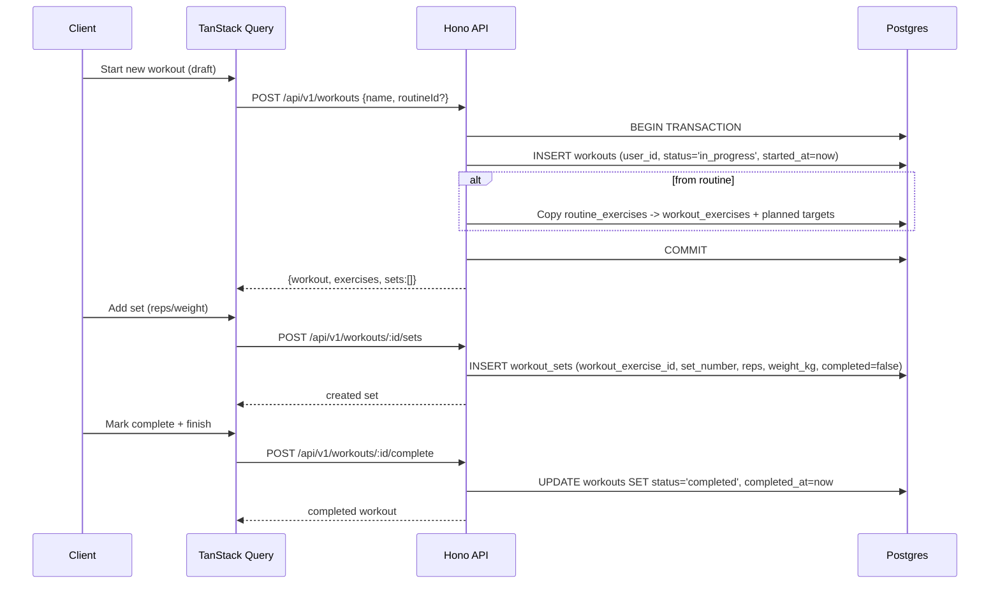
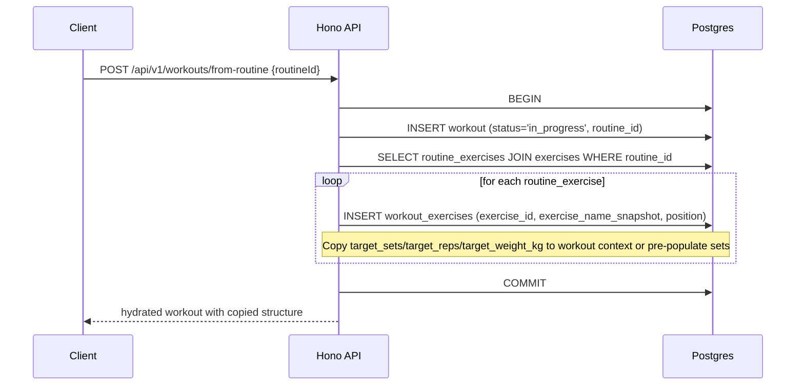
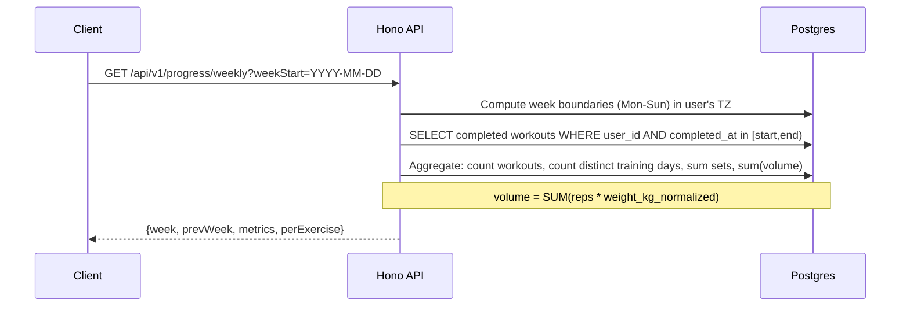
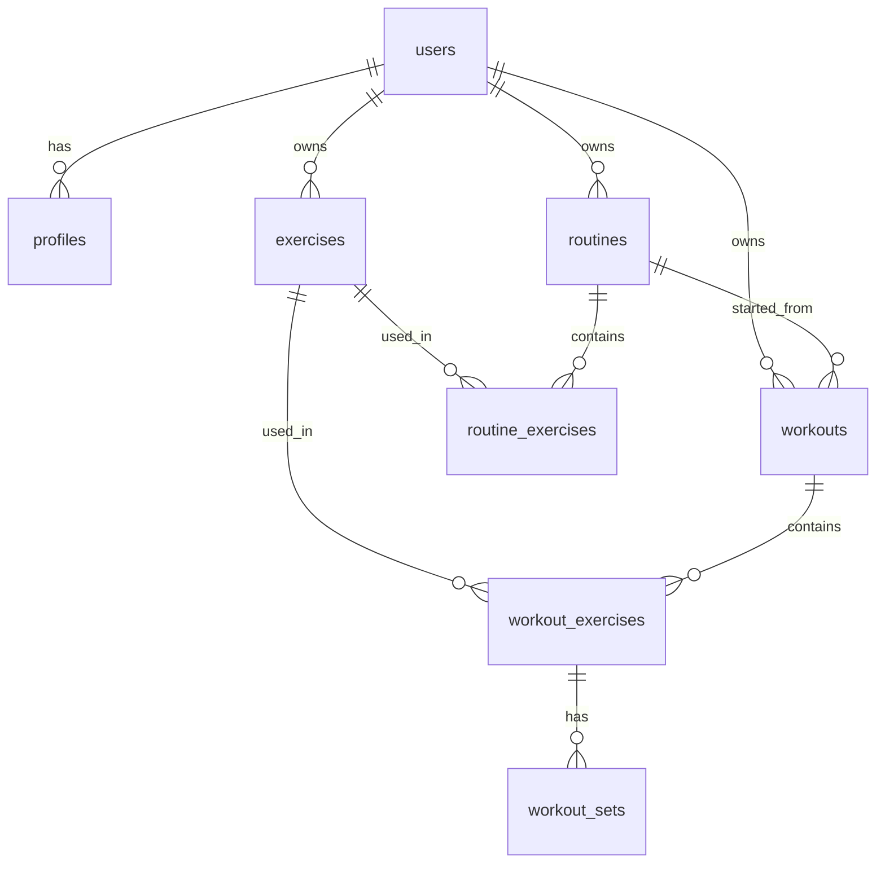

# FitPal Phase 1: Product Requirements and Technology Architecture Research Report

## A. Executive Recommendation

### Recommended Stack

For FitPal Phase 1, I recommend leveraging the existing monorepo foundation with targeted adjustments to focus strictly on the required workout tracking features.

| Layer | Recommendation | Rationale |
|---|---|---|
| **Monorepo/Tooling** | Keep Turborepo + Bun workspaces (as-is) | Already configured. Fast installs, simple scripts (`dev`, `build`, `db:*`), and good fit for a solo developer. |
| **Frontend (Web + Cross-platform path)** | **Next.js 16 (App Router) + React 19 + TypeScript + Tailwind CSS v4 + shadcn/ui** | Already scaffolded. Excellent DX, SSR/route organization, strong ecosystem. |
| **Backend/API** | **Hono on Bun** (as-is) | Already scaffolded with routes, middleware structure, and RPC-style typing potential via `AppType`. Lightweight, fast, and easy to deploy. |
| **Database** | **PostgreSQL** via **Drizzle ORM** in `packages/database` | Relational fit for workouts/sets/routines (one-to-many with ordering). Drizzle is type-safe, migration-friendly, and keeps SQL transparent. |
| **Authentication** | **Extend existing custom auth** (session cookies + Redis) with better account lifecycle support | The repo already has email/password + Google OAuth, sessions in Redis, secure httpOnly cookies. For Phase 1 this avoids vendor lock-in and meets requirements (reset/delete) with less complexity than adopting a full managed auth SDK unless needed. |
| **State Management/Data Fetching** | **TanStack Query** for server state, **React Context/Zustand** minimally for local UI/draft state | Avoids overusing global stores. TanStack Query handles caching, retries, and optimistic updates well for workout logging. |
| **Forms/Validation** | **React Hook Form + Zod** (shared schemas in `packages/shared`) | Great for nested forms (sets), numeric validation, and sharing types between web/api. |
| **Charts/Progress** | **Recharts** | Already listed in ARCHITECTURE.md, reasonable bundle size, works on web, and easy to extend. For RN later can swap, but web-first is fine. |
| **Caching/Realtime (Phase 1)** | **Redis** for sessions/rate limiting; defer WebSockets unless strictly necessary | ARCHITECTURE.md includes WS, but Phase 1 doesn't require live multi-device sync of an *active* workout in real-time. Focus on incremental saves + draft recovery first. |
| **Storage/Other** | **Defer Meilisearch/S3/AI until needed** | Remove or disable unused services for Phase 1 to minimize cost/complexity. |

### Most Important Alternatives Considered

| Alternative | When Preferable | Notes |
|---|---|---|
| **Supabase (Auth + Postgres + RLS)** | If you want zero custom auth/session code and managed infra from day 1. | Very fast to bootstrap. Trade-offs: RLS must be designed carefully, vendor lock-in, and some edge cases with server actions/API routes. |
| **Firebase (Auth + Firestore)** | If you prioritize offline-first and mobile-first with minimal SQL. | Firestore is document-based - modeling ordered sets/routines/historical snapshots is less natural and querying aggregates (weekly volume) can get expensive/awkward. |
| **Expo + React Native + React Native Web (single codebase)** | If mobile apps are a hard requirement for launch and you want one UI codebase. | Great reuse, but web experience can feel "mobile-first". Also need to validate charting, form inputs, and keyboard handling. Current repo is web-first (Next.js). |
| **Custom NestJS/Fastify backend separate from Next.js** | If API needs to be consumed by multiple unrelated clients with complex domain services. | Overkill for Phase 1. Hono already exists and is sufficient. |

### Major Trade-offs

- **Leverage existing vs refactor**: The repo is already set up for a much larger app (nutrition, social, AI). For Phase 1, we should *constrain scope* to workouts/routines/logbook/progress, not rip everything out.
- **Custom auth vs managed**: Custom gives control and no forced pricing tiers, but we must harden session security, password reset, and account deletion ourselves.
- **Web-first now, mobile later**: Next.js + shared packages (`@fitpal/shared`, `@fitpal/database`) gives a clean path to Expo later without premature rewriting.
- **Simplicity over real-time**: Skip WebSockets for Phase 1 in favor of reliable incremental persistence (drafts) to avoid complexity.

### Assumptions

- **Environment**: Bun runtime available, Postgres + Redis available locally via Docker (as per `docker/`).
- **Internet access**: Not guaranteed in this environment. Version checks for third-party libs should be validated against official docs when possible, but recommendations are based off of what's already in the repo and stable, well-documented APIs.
- **Scope**: Strictly Phase 1 as defined. Features like nutrition/social/AI are out of scope despite existing scaffolding.

---


## B. Technology Comparison

| Category | Recommended | Alternatives | Dev Effort | Code Reuse | Security | Cost | Maintainability | Scalability | Vendor Lock-in |
|---|---|---|---|---|---|---|---|---|---|
| **Framework (Cross-platform)** | **Next.js 16 + React 19 (Web) + shared packages** | Expo + RN + RNWeb; Separate Next.js + RN/Flutter | Next.js: Low (existing). Expo: Med-High to match web parity. Separate: Highest. | Next.js: High for web + shared TS. Expo: Highest if mobile is primary. Separate: Lowest. | Next.js: Strong with proper middleware/headers. Expo: Strong. | Next.js: Vercel free tier possible, but can scale. | Next.js: Great for web, clear path to share logic. | Good for Phase 1, can scale horizontally. | Low if using open source. |
| **Backend** | **Hono on Bun** | NestJS, Fastify, Next.js Route Handlers only | Hono: Low (existing). NestJS: High. Route Handlers only: Low but can blur layers. | High via `@fitpal/shared` types. | Good with middleware + Zod validation. | Cheap to self-host (Railway/Fly.io free tiers vary). | Lightweight, easy to reason about. | Horizontally scalable. | Very low. |
| **Database** | **PostgreSQL + Drizzle** | Supabase Postgres, Neon, PlanetScale (MySQL), Firebase Firestore | Drizzle: Low (existing). Supabase: Low. Firestore: Med (schema redesign). | High, type-safe across packages. | Enforce via app-layer auth + can add RLS if using managed Postgres. | Neon/Supabase have free tiers, but limits exist. | Migrations explicit, SQL transparent. | Excellent for relational data. | Low if Postgres. |
| **Auth** | **Custom (sessions + Redis + bcrypt + Google OAuth)** | Better Auth (managed-like), Supabase Auth, NextAuth/Auth.js, Clerk | Custom: Med (extend existing). Better Auth: Low. Clerk: Low. | High with shared types. | Must implement correctly (cookies, CSRF, reset, deletion). | Free mostly (Redis may cost). Clerk has free tier but usage-based. | Full control, no forced UI lock-in. | Scalable. | Low. |
| **State Management** | **TanStack Query + minimal Zustand/Context** | Redux Toolkit, Jotai, SWR, React Query alternatives | Low. | High. | N/A (client state). | Free. | Easy to prune. | Good. | None. |
| **Forms/Validation** | **React Hook Form + Zod** | Formik + Yup, TanStack Form, native HTML validation | Low. | High via shared Zod schemas. | Prevents bad data at client+server. | Free. | Great for nested sets. | Good. | None. |
| **Charts** | **Recharts** | Victory Native/Web, Chart.js, Visx, react-native-svg-charts (RN) | Low. | Decent on web; RN needs alternative. | N/A. | Free (MIT). | Mature. | Good. | None. |
| **Testing** | **Vitest + RTL + Playwright** | Jest, Cypress, Maestro (mobile) | Low to setup incrementally. | High. | Helps catch authz/data issues. | Free. | Focused on critical logic. | Good. | None. |
| **Hosting/Deploy** | **Vercel (web) + Railway/Fly.io (API) + Neon/managed Postgres + Upstash Redis** | Render, Netlify, Supabase hosting, self-host Docker | Med. | N/A. | Need env management. | Generous free tiers possible but not guaranteed. | Manageable for solo dev. | Can scale. | Moderate if PaaS-heavy. |

*Note*: Benchmarks not invented. Assessments are qualitative based off repository state and official docs patterns.

---


## C. Recommended Architecture

### Architecture Diagram (Mermaid)

```mermaid
graph TD
  subgraph Clients
    Web[Next.js 16 Web App]
    PWA[PWA - future]
    Mobile[React Native - future]
  end

  subgraph Edge
    Vercel[Vercel CDN/Edge]
  end

  subgraph Frontend
    WebApp[apps/web - App Router]
  end

  subgraph API
    Hono[apps/api - Hono on Bun]
    AuthMW[Auth Middleware]
    ValMW[Zod Validation]
    Routes[Routes: auth/workouts/routines/logbook/progress]
  end

  subgraph Data
    PG[(PostgreSQL)]
    Redis[(Redis - Sessions/Cache/RateLimit)]
    S3[(S3/MinIO - deferred)]
  end

  subgraph Shared
    DBPkg[@fitpal/database - Drizzle Schema]
    SharedPkg[@fitpal/shared - Types/Zod]
  end

  Web --> Vercel
  Vercel --> WebApp
  WebApp -->|HTTP/JSON via RPC-style client| Hono
  Hono --> AuthMW
  AuthMW --> ValMW
  ValMW --> Routes
  Routes --> DBPkg
  Routes --> SharedPkg
  DBPkg --> PG
  Hono --> Redis
  WebApp --> SharedPkg
```

### Component Descriptions

| Component | Purpose |
|---|---|
| `apps/web` | Next.js App Router UI. Server Components where possible, Client Components for interactive workout forms. Uses TanStack Query for mutations/queries. |
| `apps/api` | Hono API with modular routes. Handles auth, workouts, routines, logbook, progress. Middleware for auth, validation, rate limiting. |
| `packages/database` | Drizzle schema, migrations, DB client. Single source of truth for tables/relations. |
| `packages/shared` | TypeScript types and Zod schemas shared between web and api (prevents drift). |
| `PostgreSQL` | Relational store for users, exercises, routines, workouts, sets. |
| `Redis` | Session storage, draft caching (optional), rate limiting. |

### Request & Data Flows

1. **Authenticated Request**: Browser sends request with `session` httpOnly cookie → Next.js may proxy or call API directly → Hono auth middleware validates session via Redis → loads user context → authorized query to Postgres via Drizzle → returns JSON.
2. **Form Submission**: React Hook Form + Zod on client validates → TanStack Query mutation to API → server validates again (Zod) → transaction in DB → invalidate queries.
3. **Draft Recovery**: On app load/resume, check local draft (localStorage/IndexedDB) and/or server draft endpoint → hydrate workout screen.

### Authentication & Authorization Flow

```mermaid
sequenceDiagram
  participant C as Client
  participant W as Next.js/Web
  participant A as Hono API
  participant R as Redis
  participant DB as Postgres

  C->>W: GET /login
  C->>A: POST /api/v1/auth/login (email/pass)
  A->>DB: Verify user + bcrypt
  A->>R: Create session {userId, expires}
  A-->>C: Set-Cookie: session=... HttpOnly; Secure; SameSite=Lax
  C->>A: GET /api/v1/workouts (cookie)
  A->>R: validateSession(sessionId)
  R-->>A: session valid + userId
  A->>DB: SELECT workouts WHERE user_id = :uid
  DB-->>A: results
  A-->>C: 200 workouts
```

- **Sessions**: httpOnly, Secure (prod), SameSite=Lax, 7-day expiry (configurable). Stored in Redis with key `session:{id}` mapping to `userId` + metadata.
- **Authorization**: Every data endpoint must filter by `user_id = session.userId`. Never trust client-supplied user ids. Prefer enforcing at query level (and consider RLS if moving to managed Postgres with direct client access - not planned for Phase 1 API-first).
- **Password reset**: Generate time-limited token (crypto random), store hashed token in DB with expiry, email link. Invalidate on use.
- **Account deletion**: Soft-delete or hard-delete with cascading. Must delete all user-owned data (workouts, sets, routines, exercises, profile). Explicit confirmation required.

### Workout Logging Flow



**Notes**: Incremental saves on each mutation. Draft persisted server-side (in-progress workout) and optionally cached client-side for resilience.

### Routine-Based Workout Creation Flow



**Critical**: Copy to snapshots (see D). Do not reference live routine_exercises after copying - changing routine must not affect completed/in-progress workouts.

### Weekly Progress Calculation Flow



- **Boundary**: Use user's local timezone (from profile). Default Monday start, make configurable later if needed.
- **Only completed**: Filter `status='completed'` and `completed_at IS NOT NULL`.
- **Efficiency**: Compute via SQL aggregations where possible; avoid loading full history. Cache lightly if needed.

---


## D. Database Design

### Improved Schema (Proposed)

This improves on the ARCHITECTURE.md sketch for Phase 1 focus (workouts/routines/exercises/sets/logbook/progress).



### Table Definitions

#### `users` (extend existing)
Already exists. Ensure it has `deleted_at` (soft delete) for account deletion flows, or handle hard delete with cascades. Also consider `timezone` (for week boundaries) and ensure `unit_system` is present.

#### `profiles` (new, 1:1 with users)
```sql
profiles (
  id UUID PRIMARY KEY DEFAULT gen_random_uuid(),
  user_id UUID NOT NULL UNIQUE REFERENCES users(id) ON DELETE CASCADE,
  display_name TEXT,
  weight_unit TEXT NOT NULL DEFAULT 'kg' CHECK (weight_unit IN ('kg','lb')),
  timezone TEXT NOT NULL DEFAULT 'UTC',
  created_at TIMESTAMPTZ NOT NULL DEFAULT now(),
  updated_at TIMESTAMPTZ NOT NULL DEFAULT now()
);
```

#### `exercises` (user-defined)
```sql
exercises (
  id UUID PRIMARY KEY DEFAULT gen_random_uuid(),
  user_id UUID NOT NULL REFERENCES users(id) ON DELETE CASCADE,
  name TEXT NOT NULL,
  normalized_name TEXT NOT NULL, -- lowercase, trimmed, collapsed spaces
  created_at TIMESTAMPTZ NOT NULL DEFAULT now(),
  updated_at TIMESTAMPTZ NOT NULL DEFAULT now(),
  UNIQUE(user_id, normalized_name)
);
```
- **Normalization**: Compute on insert/update (lowercase, trim, remove extra spaces). Helps deduplicate.
- **History**: Don't delete exercises if referenced - use soft delete (`deleted_at`) or just prevent deletion if in use; better to keep for historical accuracy.

#### `routines`
```sql
routines (
  id UUID PRIMARY KEY DEFAULT gen_random_uuid(),
  user_id UUID NOT NULL REFERENCES users(id) ON DELETE CASCADE,
  name TEXT NOT NULL,
  created_at TIMESTAMPTZ NOT NULL DEFAULT now(),
  updated_at TIMESTAMPTZ NOT NULL DEFAULT now()
);
CREATE INDEX idx_routines_user_id ON routines(user_id);
```

#### `routine_exercises` (ordered)
```sql
routine_exercises (
  id UUID PRIMARY KEY DEFAULT gen_random_uuid(),
  routine_id UUID NOT NULL REFERENCES routines(id) ON DELETE CASCADE,
  exercise_id UUID NOT NULL REFERENCES exercises(id) ON DELETE RESTRICT,
  position INT NOT NULL,
  target_sets INT,
  target_reps TEXT, -- or JSONB for ranges; TEXT flexible for "8-12"
  target_weight_kg NUMERIC(10,3), -- store in canonical kg; convert on display
  created_at TIMESTAMPTZ NOT NULL DEFAULT now(),
  updated_at TIMESTAMPTZ NOT NULL DEFAULT now(),
  UNIQUE(routine_id, position),
  UNIQUE(routine_id, exercise_id) -- prevent duplicate exercise in same routine
);
CREATE INDEX idx_routine_exercises_routine_id ON routine_exercises(routine_id);
```

#### `workouts`
```sql
workouts (
  id UUID PRIMARY KEY DEFAULT gen_random_uuid(),
  user_id UUID NOT NULL REFERENCES users(id) ON DELETE CASCADE,
  routine_id UUID REFERENCES routines(id) ON DELETE SET NULL,
  name TEXT,
  status TEXT NOT NULL DEFAULT 'in_progress' CHECK (status IN ('in_progress','completed')),
  started_at TIMESTAMPTZ NOT NULL DEFAULT now(),
  completed_at TIMESTAMPTZ,
  created_at TIMESTAMPTZ NOT NULL DEFAULT now(),
  updated_at TIMESTAMPTZ NOT NULL DEFAULT now(),
  CONSTRAINT chk_completed_times CHECK (
    (status='completed' AND completed_at IS NOT NULL) OR
    (status='in_progress' AND completed_at IS NULL)
  )
);
CREATE INDEX idx_workouts_user_id_started_at ON workouts(user_id, started_at DESC);
CREATE INDEX idx_workouts_user_id_status ON workouts(user_id, status);
```

#### `workout_exercises` (snapshot)
```sql
workout_exercises (
  id UUID PRIMARY KEY DEFAULT gen_random_uuid(),
  workout_id UUID NOT NULL REFERENCES workouts(id) ON DELETE CASCADE,
  exercise_id UUID REFERENCES exercises(id) ON DELETE SET NULL,
  exercise_name_snapshot TEXT NOT NULL, -- preserve name at time of logging
  position INT NOT NULL,
  created_at TIMESTAMPTZ NOT NULL DEFAULT now(),
  updated_at TIMESTAMPTZ NOT NULL DEFAULT now(),
  UNIQUE(workout_id, position)
);
CREATE INDEX idx_workout_exercises_workout_id ON workout_exercises(workout_id);
```
- **Snapshot**: Store `exercise_name_snapshot` so renaming/deleting exercise doesn't change historical display. Keep `exercise_id` nullable for flexibility.

#### `workout_sets` (independent)
```sql
workout_sets (
  id UUID PRIMARY KEY DEFAULT gen_random_uuid(),
  workout_exercise_id UUID NOT NULL REFERENCES workout_exercises(id) ON DELETE CASCADE,
  set_number INT NOT NULL,
  reps INT,
  weight_kg NUMERIC(10,3), -- canonical unit (kg)
  completed BOOLEAN NOT NULL DEFAULT false,
  created_at TIMESTAMPTZ NOT NULL DEFAULT now(),
  updated_at TIMESTAMPTZ NOT NULL DEFAULT now(),
  UNIQUE(workout_exercise_id, set_number)
);
CREATE INDEX idx_workout_sets_workout_exercise_id ON workout_sets(workout_exercise_id);
```
- **Each set independent** as required. `reps`/`weight_kg` nullable to allow flexibility (some exercises timed/bodyweight).

### Key Design Decisions

| Decision | Choice | Rationale |
|---|---|---|
| **Exercise identity** | User-scoped exercises with `normalized_name` + keep snapshots on history | Allows reuse, prevents cross-user leakage, and `exercise_name_snapshot` + `exercise_id` nullable preserves history even if exercise renamed/deleted. |
| **Routine snapshots** | Copy to `workout_exercises` on "start from routine" (snapshot name, copy targets) | Changing routine later won't affect completed/in-progress workouts. Targets can be copied to pre-populate sets or just displayed as "planned". |
| **Weight storage** | **Canonical kg** in DB (`weight_kg`), display in user's `weight_unit` with conversion | Avoids corruption on unit changes, easier aggregation, consistent precision. Convert using `1 lb = 0.45359237 kg`. Round display reasonably (e.g., 1 decimal or integer based on value). |
| **Duration** | Derive from `workouts.started_at`/`completed_at` (store both). Don't require separate `duration_minutes` computed column unless needed for indexing | Flexible, accurate. Can compute in SQL or app layer. |
| **Deletion** | `ON DELETE CASCADE` for user-owned children, `ON DELETE SET NULL` for references like `routine_id`/`exercise_id` where history must persist | Preserves logbook integrity. |
| **Indexes** | User-scoped indexes on time (`user_id, started_at DESC`) and lookups by workout/exercise | Critical for logbook and weekly queries. |
| **Constraints** | CHECKs for status/times, UNIQUEs for ordering/deduplication | Enforces data integrity at DB level. |

### Example Migration Notes (High-Level)

```sql
-- 001_create_users_profiles_exercises.sql
CREATE TABLE profiles (...);
CREATE TABLE exercises (...);
CREATE UNIQUE INDEX exercises_user_norm_unique ON exercises(user_id, normalized_name);

-- 002_create_routines.sql
CREATE TABLE routines (...);
CREATE TABLE routine_exercises (...);

-- 003_create_workouts.sql
CREATE TABLE workouts (...);
CREATE TABLE workout_exercises (...);
CREATE TABLE workout_sets (...);

-- Add indexes as above
```
Migrations via Drizzle Kit. Version-controlled in `packages/database/src/migrations/`.

---


## E. Cost and Deployment Assessment

### Free Tier Availability (as of general knowledge - verify against official pricing)

| Service | Free Tier | Usage Limits (typical) | Production Suitability | Notes |
|---|---|---|---|---|
| **Vercel** (Web) | Yes | Hobby plan limits apply; bandwidth/functions have quotas | Good for Phase 1, watch for usage spikes | Great Next.js integration. |
| **Railway** (API) | Yes (trial/usage-based) | Often has usage-based free credits or limits; changes over time | Possible for small projects | Check current pricing. |
| **Fly.io** (API) | Yes | Free allowances for small VMs, bandwidth limits | Good alternative | More hands-on but generous in places. |
| **Neon** (Postgres) | Yes | Free tier with compute/storage limits, branching | Good for dev+small prod | Serverless, pauses possible. |
| **Supabase** (Postgres+Auth) | Yes | Database size, auth MAU limits | Good | Convenient but watch limits. |
| **Upstash Redis** | Yes | Request limits on free tier | Good for sessions/rate limiting | REST/Redis compatible. |
| **Cloudflare R2** | Yes | Generous egress-free storage, some operation limits | Good if need object storage later | Better for egress than S3. |
| **GitHub Actions** | Yes | Free minutes for public/private with limits | Good for CI | Sufficient for lint/typecheck/tests. |

**Important**: Free tiers can change. Do not assume permanence. Set alerts/monitoring early.

### Estimated Monthly Costs (Small Personal Project)

| Category | Phase 1 Estimate | Notes |
|---|---|---|
| **Development** | $0 | Solo dev, existing tools. |
| **Database** | $0 - $20 | Neon/Supabase free likely enough initially. May grow with data. |
| **Auth** | $0 | Custom is free; managed can become paid at scale. |
| **API Hosting** | $0 - $15 | Railway/Fly.io free tiers may suffice. |
| **Web Hosting** | $0 | Vercel Hobby. |
| **Redis** | $0 - $10 | Upstash free tier possible. |
| **Storage** | $0 | Defer until needed. |
| **Monitoring/Error Reporting** | $0 | Can start with logs; add Sentry/PostHog later (free tiers exist). |
| **Total** | **~$0 - $30/month max** | Very reasonable if staying within free tiers. |

### Deployment Strategy

- **Web**: Deploy `apps/web` to Vercel. Set env vars (API URL, etc.).
- **API**: Deploy `apps/api` to Railway or Fly.io as a Bun service. Expose HTTPS endpoint.
- **Database**: Neon/Supabase Postgres. Run migrations via Drizzle Kit in CI or locally before deploy.
- **Redis**: Upstash.
- **Env**: Use `.env.example` as template, never commit secrets. Different envs for dev/staging/prod.
- **Migrations**: `bun run db:generate && bun run db:migrate` (or CI job). Backups important for prod.

**Difference**: Web deployment is static/SSR hosting; mobile distribution requires app store builds (signing, reviews) - out of scope for Phase 1 web focus but good to note.

---


## F. Implementation Roadmap

### Milestone 1: Project Foundation and Authentication (Week 1)
**Goal**: Harden existing auth and prepare schema foundation.

**Prerequisites**: Repo inspected, DB/Redis available locally.

**Tasks**:
- [ ] Extend user/profile schema (add `profiles` table, ensure timezone/unit_system)
- [ ] Add password reset flow (tokens, endpoints, basic UI)
- [ ] Add account deletion flow (confirmation, cascade deletes)
- [ ] Improve auth middleware/error handling
- [ ] Add shared types/schemas for auth in `packages/shared`
- [ ] Basic auth UI pages in web app

**Acceptance Criteria**:
- User can register/login/logout
- Password reset works end-to-end
- Account deletion removes user data
- Sessions secure (httpOnly cookies)

**Tests**: Auth service unit tests, route integration tests

**Dependencies**: None

### Milestone 2: Manual Workout Logging (Week 2)
**Goal**: Core workout tracking as specified.

**Prerequisites**: Milestone 1 complete, schema for exercises/workouts/sets.

**Tasks**:
- [ ] Create schema: `exercises`, `workouts`, `workout_exercises`, `workout_sets`
- [ ] API endpoints: create/start workout, add/edit/remove exercises/sets, mark complete
- [ ] Exercise name normalization & reuse logic
- [ ] Workout screen UI (add exercises, sets table with reps/weight/completed)
- [ ] Draft persistence (in-progress workout)
- [ ] Shared validation schemas

**Acceptance Criteria**:
- Start workout from scratch, add exercises/sets, complete and save
- Each set stored independently
- Can edit/remove/reorder exercises and sets
- Draft recovery on refresh/close

**Tests**: Workout service unit tests (set calculations), component tests, API integration tests

**Dependencies**: M1

### Milestone 3: Routine Builder (Week 3)
**Goal**: Reusable routines with snapshots.

**Prerequisites**: M2 schema patterns established.

**Tasks**:
- [ ] Schema: `routines`, `routine_exercises`
- [ ] API: CRUD routines, add/remove/reorder exercises, set targets
- [ ] UI: Routine builder and list
- [ ] "Start workout from routine" - copy snapshot to workout_exercises/sets
- [ ] Ensure routine changes don't affect completed workouts

**Acceptance Criteria**:
- Create/edit/delete routines
- Start workout from routine copies planned exercises/targets
- Completed workouts remain unchanged if routine edited

**Tests**: Snapshot logic tests, API tests

**Dependencies**: M2

### Milestone 4: Historical Logbook (Week 4)
**Goal**: Workout history and details.

**Prerequisites**: M2/M3 complete.

**Tasks**:
- [ ] API: list workouts (paginated), get workout details, edit/delete historical workouts
- [ ] UI: Logbook list (chronological), workout detail view
- [ ] Distinguish completed vs in-progress
- [ ] Date/week navigation

**Acceptance Criteria**:
- View history chronologically
- Navigate to workout details with all sets
- Edit/delete historical workouts
- Filter by date/week

**Tests**: Query performance tests, API tests

**Dependencies**: M2, M3

### Milestone 5: Weekly Progress Dashboard (Week 5)
**Goal**: Metrics as specified.

**Prerequisites**: M4 complete with completed workouts.

**Tasks**:
- [ ] API: weekly progress endpoint (Mon-Sun, user TZ)
- [ ] Calculations: completed workouts, active days, sets, volume (kg normalized), per-exercise history, week comparison
- [ ] UI: Dashboard with metrics and simple charts (Recharts)
- [ ] Unit conversion display based on user preference

**Acceptance Criteria**:
- Correct week boundaries (Mon-Sun) using user timezone
- Only completed workouts counted
- Volume calculated with normalized kg
- Comparison with previous week
- Handles unit switching without corrupting history

**Tests**: Calculation unit tests (volume, boundaries, TZ), API tests

**Dependencies**: M4

### Milestone 6: Cross-Platform Testing and Release (Week 6)
**Goal**: Polish, test, prepare release.

**Prerequisites**: M1-M5 complete.

**Tasks**:
- [ ] E2E tests (Playwright) for critical flows
- [ ] Unit tests for business logic
- [ ] Responsive testing (web)
- [ ] Error handling, loading states
- [ ] Env/config docs
- [ ] Deploy to staging (Vercel + Railway + Neon)
- [ ] Security review (authz checks)

**Acceptance Criteria**:
- All critical flows pass E2E
- No user can access another user's data (authz tests)
- App works on mobile/desktop browsers
- Staging deployment successful

**Tests**: Full test suite

**Dependencies**: M1-M5

**Opportunity**: Build end-to-end flow early - after M2 you have a usable "log a workout" flow. Prioritize that for validation.

---


## G. Risks and Unresolved Decisions

### Major Technical Risks

| Risk | Impact | Likelihood | Mitigation |
|---|---|---|---|
| **Scope creep** (nutrition/social/AI from ARCHITECTURE.md) | High | High | Strictly follow Phase 1 requirements. Disable/comment unused routes. |
| **Custom auth bugs** (sessions, reset, deletion) | High | Med | Follow secure patterns, add tests, use httpOnly/Secure cookies, rate limit auth endpoints. |
| **Data integrity** (snapshots, history) | High | Med | Use transactions, snapshots, constraints, and integration tests. |
| **Unit conversion errors** | Med-High | Med | Store canonical kg, test conversions, be explicit about rounding. |
| **Week boundary/TZ issues** | Med-High | Med | Use user's timezone, test edge cases (DST), default Mon-Sun. |

### Security Risks

| Risk | Impact | Likelihood | Mitigation |
|---|---|---|---|
| **Broken authorization** (cross-user access) | Critical | Med | Always filter by `user_id` from session; add authz tests; consider middleware helper. |
| **Session hijacking** | High | Med | httpOnly, Secure, SameSite, short/rotated sessions, Redis storage. |
| **Password reset abuse** | High | Med | Rate limit, short expiry, single-use tokens, hash tokens. |
| **SQL injection** | High | Low | Drizzle parameterized queries. |
| **Secret exposure** | Critical | Low | Use env vars, `.env.example`, never commit secrets. |

### Data Integrity Risks

| Risk | Impact | Likelihood | Mitigation |
|---|---|---|---|
| **Routine changes affect history** | High | Med | Snapshot on workout creation (as designed). |
| **Exercise deletion/rename breaks history** | High | Med | `exercise_name_snapshot` + nullable `exercise_id`. |
| **Orphaned sets/exercises** | Med | Med | Cascades + constraints. |
| **Duplicate submissions** | Med | Med | Idempotency keys for mutations, optimistic locking if needed. |

### Cross-Platform Limitations

| Limitation | Impact | Mitigation |
|---|---|---|
| **Web-first now** | Med | Shared packages (`@fitpal/shared`, `@fitpal/database`) ready for RN/Expo later. |
| **Keyboard handling on mobile web** | Med | Test forms on mobile browsers, use proper input types. |
| **Charts responsiveness** | Med | Recharts is responsive; test on small screens. |
| **Secure storage on web** | Med | httpOnly cookies for sessions (good). Avoid localStorage for sensitive tokens. |

### Uncertain Assumptions

- **Free tier longevity**: Hosting/DB free tiers may change pricing/limits.
- **Meilisearch/Redis needs**: May need Redis for sessions; Meilisearch not needed for Phase 1 (user types exercise names).
- **Timezone data**: Need to handle user timezone properly for weekly boundaries.
- **Mobile launch timing**: Not required for Phase 1 but affects framework choice long-term.

### Decisions Needing Approval Before Implementation

1. **Auth strategy**: Confirm extending custom auth vs adopting Better Auth/Supabase Auth (trade-off control vs effort).
2. **Weight storage precision**: Approve `NUMERIC(10,3)` for kg and display rounding rules.
3. **Routine snapshot granularity**: Confirm copying exercises/targets (and whether to pre-populate sets) vs just structure.
4. **Draft persistence**: Approve server-side in-progress workout as source of truth + client draft fallback.
5. **Scope freeze**: Explicitly disable nutrition/social/AI routes for Phase 1 to avoid scope creep.

---


## H. Official References

### Official Documentation (Recommended)

| Technology | Documentation | Notes |
|---|---|---|
| **Next.js 16** | [https://nextjs.org/docs](https://nextjs.org/docs) | App Router, breaking changes noted in AGENTS.md |
| **React 19** | [https://react.dev/](https://react.dev/) | New features/changes |
| **Hono** | [https://hono.dev/](https://hono.dev/) | Routing, middleware, RPC types |
| **Drizzle ORM** | [https://orm.drizzle.team/](https://orm.drizzle.team/) | Schema, migrations, queries |
| **PostgreSQL** | [https://www.postgresql.org/docs/](https://www.postgresql.org/docs/) | SQL, constraints, indexes |
| **Bun** | [https://bun.sh/docs](https://bun.sh/docs) | Runtime, bundler |
| **TanStack Query** | [https://tanstack.com/query](https://tanstack.com/query) | Data fetching/caching |
| **React Hook Form** | [https://react-hook-form.com/](https://react-hook-form.com/) | Forms |
| **Zod** | [https://zod.dev/](https://zod.dev/) | Validation |
| **Recharts** | [https://recharts.org/](https://recharts.org/) | Charts |
| **Turborepo** | [https://turbo.build/repo/docs](https://turbo.build/repo/docs) | Monorepo |
| **shadcn/ui** | [https://ui.shadcn.com/](https://ui.shadcn.com/) | Components |

### Official Pricing Pages (Verify Current)

| Service | Pricing Page | Notes |
|---|---|---|
| **Vercel** | [https://vercel.com/pricing](https://vercel.com/pricing) | Hobby/Pro changes over time |
| **Railway** | [https://railway.app/pricing](https://railway.app/pricing) | Usage-based |
| **Fly.io** | [https://fly.io/docs/about/pricing/](https://fly.io/docs/about/pricing/) | VM/bandwidth pricing |
| **Neon** | [https://neon.tech/pricing](https://neon.tech/pricing) | Free tier limits |
| **Supabase** | [https://supabase.com/pricing](https://supabase.com/pricing) | Auth/DB limits |
| **Upstash Redis** | [https://upstash.com/pricing](https://upstash.com/pricing) | Request-based |
| **Cloudflare R2** | [https://developers.cloudflare.com/r2/pricing/](https://developers.cloudflare.com/r2/pricing/) | Storage/operations |

**Verification Status**: Web access was not guaranteed in this environment. The above are official URLs based on standard knowledge. Pricing, limits, and API capabilities should be verified against live official pages before committing to paid plans. Any version numbers (Next.js 16.2.6, etc.) are taken from the repo's `package.json` as-is.

---


## Final Answer

### 1) Single Recommended Stack
**Turborepo + Bun monorepo → Next.js 16 + React 19 (web) + Hono on Bun (API) + PostgreSQL + Drizzle ORM + Redis (sessions) + TanStack Query + React Hook Form + Zod + Recharts + shadcn/ui.** Extend the existing custom auth (sessions + Google OAuth) and shared packages (`@fitpal/database`, `@fitpal/shared`). Focus strictly on Phase 1 workout features, defer Meilisearch/S3/AI/WebSockets.

### 2) Strongest Alternative & When Preferable
**Supabase (Auth + Postgres + RLS)**. Prefer this if you want to minimize auth/session code and infrastructure management from day 1, and you're comfortable designing RLS policies. Trade-off: less control, potential vendor lock-in, and you must be careful not to rely on client-side direct DB access without proper policies.

### 3) Five Most Important Architecture Decisions
1. **Snapshots for history** (exercises/routines) - prevent retroactive changes to completed workouts
2. **Canonical units** - store weights in kg, convert on display
3. **Authz-first** - filter all queries by `user_id` from session (never trust client)
4. **Incremental persistence** - save drafts/sets as you go for resilience
5. **Relational schema with constraints** - enforce ordering, uniqueness, and integrity at DB level

### 4) Biggest Risks to Address Early
1. **Authorization** - cross-user data leakage (must test thoroughly)
2. **Auth flows** - password reset and account deletion correctness/security
3. **Data snapshots** - ensure routine/exercise history never breaks
4. **Scope creep** - resist adding nutrition/social/AI
5. **Migrations** - version and test schema changes carefully

### 5) Concrete Next Step to Approve Before Implementation
**Approve the Phase 1 schema (Deliverable D) and Milestone 1 plan.** Specifically:
- Create `profiles`, `exercises`, `routines`, `routine_exercises`, `workouts`, `workout_exercises`, `workout_sets` tables with the proposed constraints/indexes
- Implement/extend auth hardening (password reset, account deletion)
- Generate and review Drizzle migrations (no application logic changes yet)

Once approved, proceed with Milestone 1 in the existing monorepo without restructuring unrelated features.
